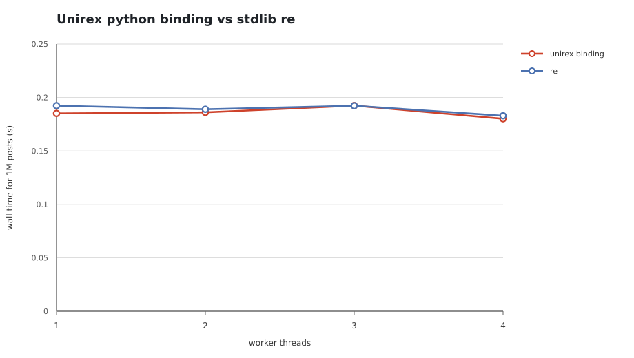
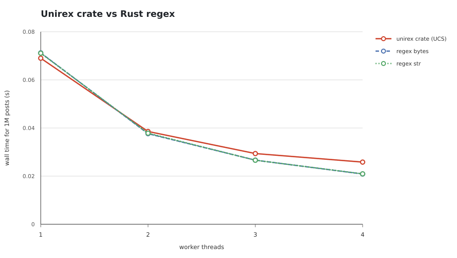

# Telegram @mention extraction: Unirex python binding vs stdlib re

Real-world task, measured as one `findall(text)` pass over every post in the corpus. Unirex matches CPython's UCS-1, UCS-2, or UCS-4 buffer directly; there is no UTF-8 conversion in the matching path. This page reports two separate measurements on the same pattern and corpus: the python binding against the standard library `re`, and the Rust crate against the `regex` crate. They are not interchangeable and their numbers are not comparable.

## Two measurements, two processes

| Measurement | Runs in | Compared with | What the time includes |
|---|---|---|---|
| Unirex python binding vs stdlib re | CPython 3.13.5 with the GIL | the `re` module, on the same strings | the scan, Python call overhead, list and result-string construction |
| unirex crate vs regex crate | a Rust process, `examples/bench.rs` | the `regex` crate over UTF-8 | only the scan, with a reused `Scratch`; no Python is involved |

## Methodology

- **Pattern** (Telegram username rules, 5 to 32 characters, `[a-zA-Z0-9_]`, starting with a letter): `@[a-zA-Z][a-zA-Z0-9_]{4,31}`
- **Corpus**: 1,000,000 posts, 470 MB of UTF-8 text (mostly Arabic and Persian), 334,136 mentions in 186,226 posts (18.6 percent of posts). The benchmark resolves the corpus from the cache or the [bench-data-telegram-v1 release](https://github.com/lorien/rurex/releases/tag/bench-data-telegram-v1) and verifies its SHA-256 before timing.
- **UCS storage**: the same posts occupy about 913 MB when packed as CPython UCS storage: 210,313 UCS-1, 331,272 UCS-2, and 458,415 UCS-4 posts. The engine scans these units directly.
- **Python binding protocol**: each engine and thread point runs in a fresh Python process. The process loads the corpus, compiles the pattern once, runs untimed warm-up passes over the corpus, and then performs one timed `findall` per post over its slice. Workers are pinned to distinct CPUs and released by a barrier. The reported wall time is the maximum across workers.
- **Rust crate protocol**: each post is scanned exactly once per run with a reused `Scratch`, called directly from `examples/bench.rs`. `ucs` uses the three CPython storage kinds, `bytes` uses Rust `regex::bytes` over UTF-8, and `str` uses Rust `regex` over UTF-8. An independent naive counter runs during loading and every mode must match it.
- **Core lease and contamination guard**: the whole matrix holds `/tmp/core4.lock`. Each point records CPU time, wall time, load, and per-CPU frequency. Runs below the efficiency floor or above the load limit are rejected and retried; a contaminated run is not published.
- **Timing window**: load, corpus resolution, pattern compilation, and warm-up are outside the window for both engines. The measured window starts when the barrier releases and stops when the worker's slice is finished.
- **Repeats**: published numbers are medians of 5 timed passes per point; the raw JSON records every run. Load was 0.31 to 1.34; crate frequency was 4.6 to 4.8 GHz; crate worker efficiency was 1.00. Python frequency samples are kept in the raw JSON as diagnostics.
- **Interpreter**: CPython 3.13.5 with the GIL. Free-threaded CPython and other interpreter versions are not measured on this page.

## Unirex python binding vs stdlib re

Both columns below are Python: the process imports the installed binding as `unirex` and calls `rx.findall(text)` per post, and the baseline is CPython's own `re` module. No Rust baseline appears in this table.



| Workers | unirex binding median (s) | unirex binding min (s) | re median (s) | re min (s) | unirex/re |
|---:|---:|---:|---:|---:|---:|
| 1 | 0.2099 | 0.2002 | 0.1902 | 0.1894 | 1.10 |
| 2 | 0.2047 | 0.1880 | 0.1877 | 0.1869 | 1.09 |
| 3 | 0.2053 | 0.1806 | 0.1921 | 0.1885 | 1.07 |
| 4 | 0.1823 | 0.1635 | 0.1877 | 0.1858 | 0.97 |

A ratio below 1 means the binding is faster. At one thread, `unirex` is 0.2099 s median and 0.2002 s minimum; `re` is 0.1902 s median and 0.1894 s minimum. That is 10.3 percent slower at the median and 5.7 percent slower at the minimum.

The GIL prevents meaningful scaling beyond one thread. The two- to four-worker medians stay close to the one-thread time, and the minimums are noisy because each scan is short and Python result construction is serialized. The one-thread result is the meaningful comparison on this page.

## unirex crate vs regex crate

Nothing in this table runs Python. `examples/bench.rs` calls the Rust crate directly through its `Ucs` haystack API and compares it with the `regex` crate over UTF-8. The python binding is not involved and these numbers exclude Python call overhead.



| Workers | unirex crate, UCS (s) | regex bytes (s) | regex str (s) | UCS/bytes |
|---:|---:|---:|---:|---:|
| 1 | 0.0754 | 0.0716 | 0.0723 | 1.05 |
| 2 | 0.0418 | 0.0378 | 0.0380 | 1.11 |
| 3 | 0.0314 | 0.0268 | 0.0268 | 1.17 |
| 4 | 0.0268 | 0.0211 | 0.0209 | 1.27 |

The binding and crate numbers answer different questions. At one thread, UCS is 0.0754 s median versus 0.0716 s for Rust `regex` bytes and 0.0723 s for Rust `regex` str. The UCS path is 5.2 percent slower than the bytes baseline at one thread.

At four threads the picture changes: UCS is 0.0268 s versus 0.0211 s for bytes and 0.0209 s for str, or 1.27 times the bytes time. The UCS path streams about 913 MB of storage against 470 MB of UTF-8, and each worker keeps its own DFA cache. This is the remaining four-thread scaling gap. It does not change the one-thread binding result.

## Reading the numbers

In the first table `unirex` is the python binding; in the second table it is the Rust crate. Whenever a row is ambiguous, the interface named in its header decides what was measured.

Parity here means the one-thread Telegram result of the python binding, not general `re` compatibility. The supported dialect is still a strict subset: `\w`, `\d`, `\s`, `\b`, `$`, flags, lazy repetition, and capture values are not implemented yet, and only group 0 is exposed. A user who needs those constructs must continue to use CPython `re`.

The crate numbers exclude Python call overhead, list construction, and result strings. They are useful for understanding the matcher, but they are not directly comparable with the binding table above.

## Free-threaded Python

Not measured yet. The binding is verified on CPython 3.13 with the GIL; free-threaded CPython 3.14t and CPython 3.10 through 3.15 are open verification tasks. The report generator rejects free-threaded points until this section is implemented, so a mixed matrix cannot silently publish GIL prose.

## Reproducing

```sh
cargo build --release --example bench
cargo build --release --features extension-module
mkdir -p var/py
cp target/release/libunirex.so var/py/unirex.so
python3 tools/telegram_benchmark.py --cpu-list 0,2,4,6 --repeat 5 --warmup-seconds 2

# Re-render the report from saved JSON without rerunning:
python3 tools/telegram_report.py --results-dir var/bench-results/telegram
```

---

*Measured 2026-10-21T19:48:48+00:00 on 13th Gen Intel(R) Core(TM) i5-13500; Python 3.13.5; compiler rustc 1.99.1 (58cf8f9c3 2026-10-13); source workspace snapshot. Raw JSON lives under `var/bench-results/telegram` and is not committed. The standalone HTML twin is generated at `docs/telegram-benchmark.html` and is gitignored.*
